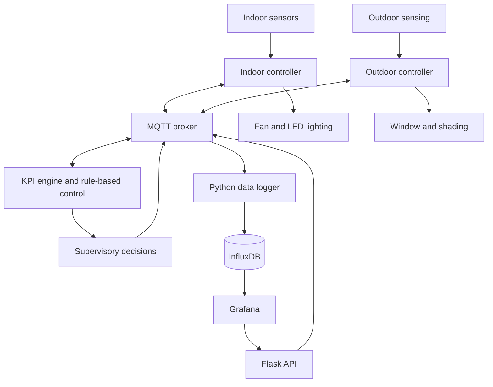

# WINECO | IoT Smart Window & Digital Twin

**Window Indoor Passive Environmental Control**

An end-to-end IoT engineering project integrating environmental sensing, automated actuation, MQTT messaging, time-series data and real-time monitoring.

     

**Politecnico di Torino · MSc ICT for Smart Societies · Interdisciplinary Projects · September 2025 – July 2026**

## Overview

WINECO is a low-cost, adaptive IoT system for indoor environmental control in smart buildings. The prototype monitors indoor and outdoor conditions, evaluates comfort indicators and coordinates window opening, shading, ventilation and LED lighting.

The project focuses on three Indoor Environmental Quality (IEQ) domains:

- Thermal comfort
- Visual comfort
- Indoor air quality (IAQ)

## Prototype demonstrations

| Demo | Video |
| --- | --- |
| Prototype demonstration 1 | [Watch on YouTube](https://www.youtube.com/shorts/dOBuY0DCuow) |
| Prototype demonstration 2 | [Watch on YouTube](https://www.youtube.com/shorts/y9vi3idJGnE) |

## System architecture



See the [architecture documentation](docs/architecture.md) for details on the physical prototype and the containerized digital twin.

## Technology stack

| Layer | Technologies |
| --- | --- |
| Edge / embedded | Raspberry Pi, Arduino, sensors and actuators |
| Application | Python, KPI evaluation, rule-based control |
| Messaging | MQTT, Eclipse Mosquitto |
| Backend | Flask, REST API, time-series logging |
| Data and monitoring | InfluxDB, Grafana |
| Deployment | Docker Compose, service health checks, persistent storage, restart policies and Grafana provisioning |
| External data | Weather API integration |

## Quick start — local digital twin

Prerequisites: Docker Engine or Docker Desktop with Compose v2.

```bash
git clone https://github.com/Alirezanourishad/WINECO.git
cd WINECO
cp cloud_rasp/.env.example cloud_rasp/.env
# Edit cloud_rasp/.env and set unique passwords and a freshly generated token.
docker compose up -d --build
docker compose ps
```

Start the simulated edge nodes and cloud bridge in separate terminals as documented in [deployment notes](docs/deployment.md). Grafana is served at http://localhost:3000, InfluxDB at http://localhost:8086 and the actuator dashboard at http://localhost:5050.

## Repository layout

```text
WINECO/
├── .github/workflows/          # CI checks
├── .devcontainer/              # Development environment
├── inside_rasp/                # Sensing and control simulation
├── outside_rasp/               # Outdoor simulation
├── cloud_rasp/                 # Logger, API, dashboard and provisioning
├── docs/                       # Architecture, deployment, experimental results
├── docker-compose.yml
├── mosquitto.conf
└── backup.sh
```

## Experimental validation

The prototype was evaluated in a real office environment from 26 to 29 May 2026.

| Metric | Reported result |
| --- | ---: |
| Operating hours across four test days | 71 h |
| Recorded data gaps | 8.46 h |
| Appropriate responses to recorded KPI violations | 96.215% |
| Positive feedback on KPI visualization | 86.25% |
| Survey respondents | 40 |

These results demonstrate control-system integration, not guaranteed comfort or energy savings. Thermal and visual comfort targets were not met, and CO₂ data limitations prevented full IAQ validation. See [experimental results](docs/experimental-results.md).

## Engineering process

Kick-off → System Requirements Review → Preliminary Design Review → Critical Design Review → Test Readiness Review → Final Review.

## Documentation

- [System architecture](docs/architecture.md)
- [Deployment notes](docs/deployment.md)
- [Experimental results and limitations](docs/experimental-results.md)

## Academic project & contributors

- Mohsen Marzban
- Alireza Nourishad
- Shabnam Amouie
- Sajjad Rezaei Chermahini

Developed as a collaborative academic project at Politecnico di Torino.

Academic supervision: Prof. Fabio Dovis and Prof. Giacomo Chiesa.

## Deployment scope

This repository provides the containerized digital twin, control logic, monitoring stack and deployment configuration for WINECO. It is designed for local simulation and experimentation.

Credentials, raw operational logs, installed third-party plugins and generated database files are excluded from version control. The physical hardware firmware is not included. End-to-end execution of the current container configuration has not yet been verified.

## Future work

- Further hardening and reproducible container deployment.
- Expand automated tests and CI checks.
- Improved sensor reliability and data-quality validation.
- Longer real-building trials and quantified energy evaluation.
- Enhanced edge autonomy and building management system integration.
