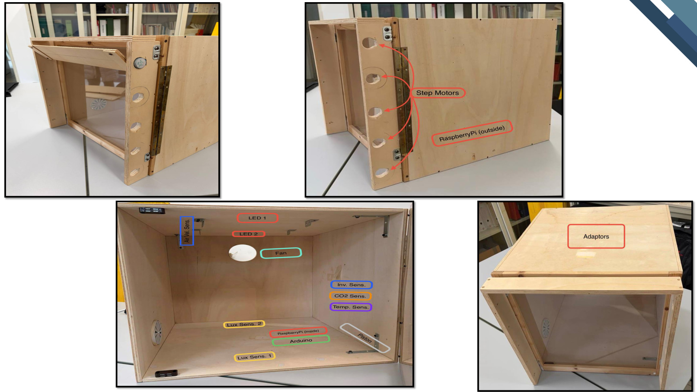
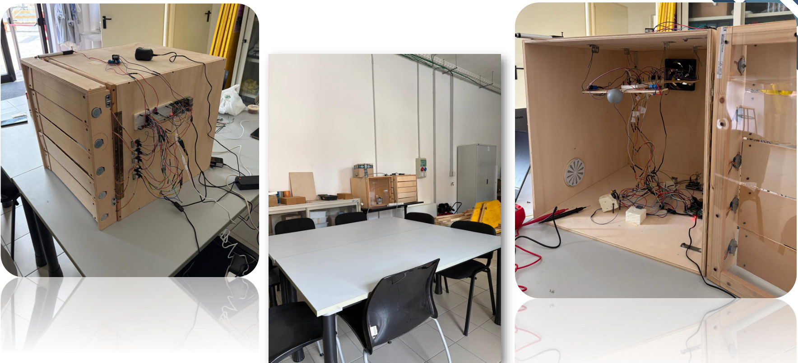
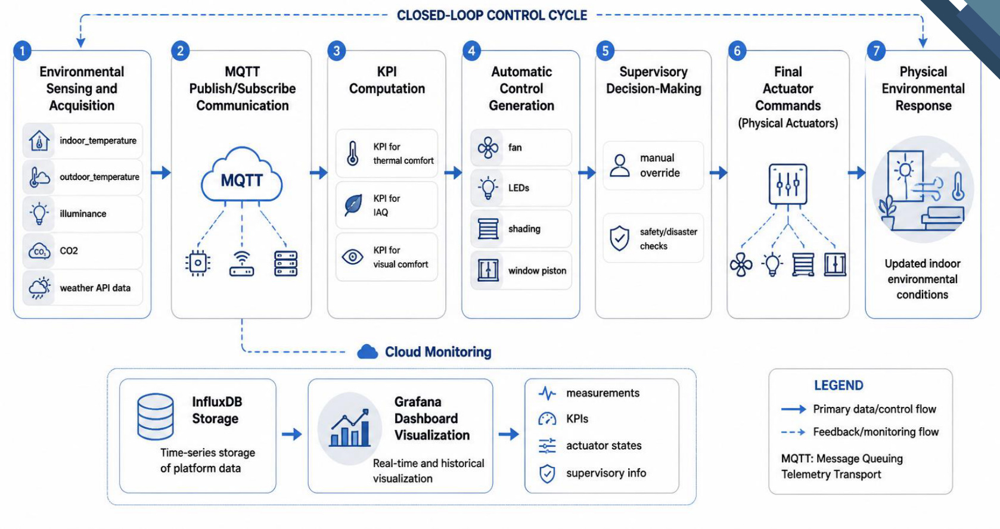
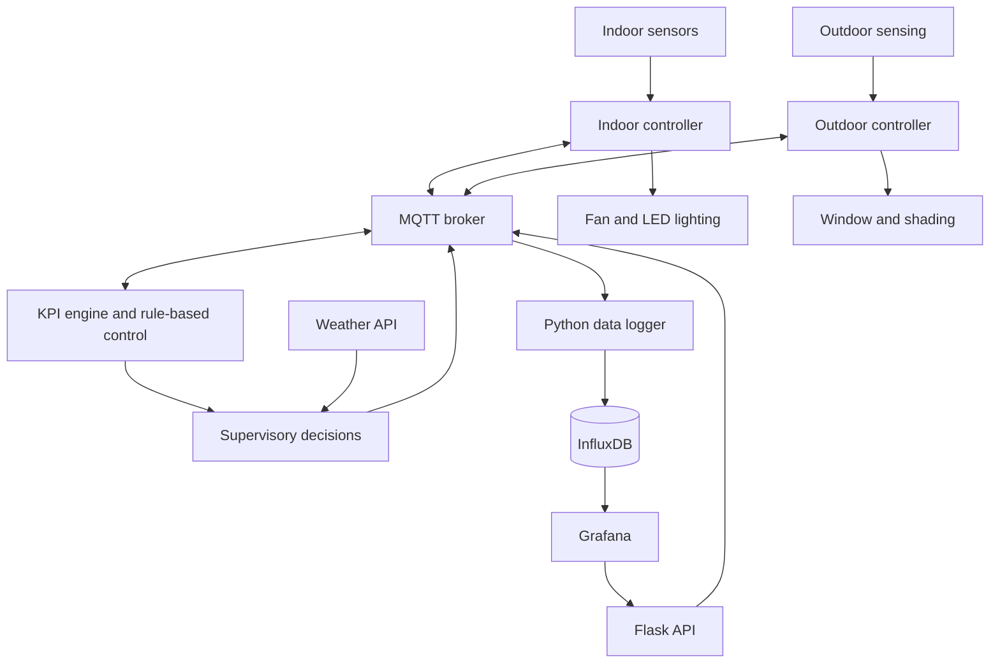
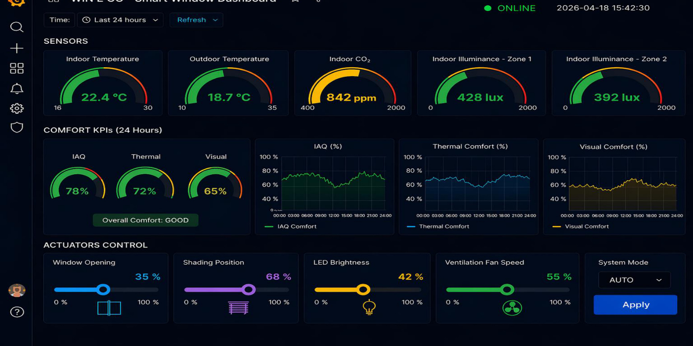
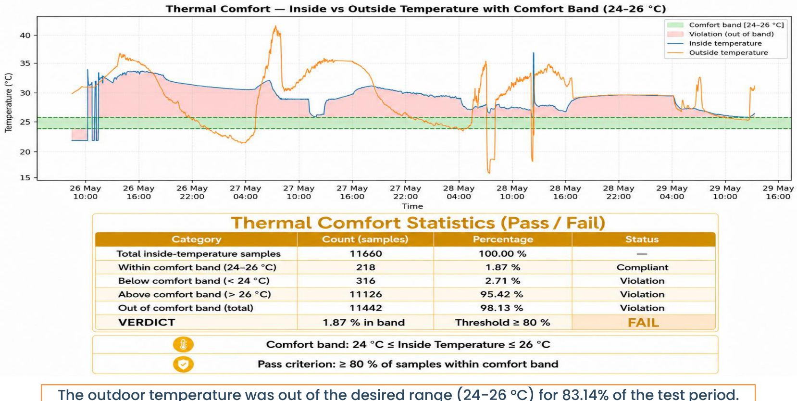

# WINECO | IoT Smart Window & Digital Twin

**Window Indoor Passive Environmental Control**

An end-to-end IoT engineering project integrating environmental sensing, automated actuation, MQTT messaging, time-series data and real-time monitoring for smart buildings.

     

**Politecnico di Torino · MSc ICT for Smart Societies · Interdisciplinary Projects · September 2025 – July 2026**



*Physical prototype during the Critical Design Review (CDR, p. 8).*

## Overview

WINECO is a low-cost, adaptive IoT system for indoor environmental control. The prototype monitors indoor and outdoor conditions, evaluates comfort indicators and coordinates window opening, shading, ventilation and LED lighting. The project focuses on three Indoor Environmental Quality (IEQ) domains: thermal comfort, visual comfort and indoor air quality (IAQ).

The project combines a physical smart-window prototype with a containerized digital twin for local simulation, data logging and visualization.

## Demonstrations

| Video | Link |
| --- | --- |
| Project demonstration 1 | [Watch on YouTube](https://www.youtube.com/shorts/dOBuY0DCuow) |
| Project demonstration 2 | [Watch on YouTube](https://www.youtube.com/shorts/y9vi3idJGnE) |



*Office installation and physical test setup (TRR, p. 12).*

## System architecture



*System operation workflow (FR, p. 5).*



The sensing and control layers exchange data through MQTT. The control engine generates actuator commands using comfort indicators and supervisory rules. The monitoring layer records time-series measurements and exposes visualization and manual-control interfaces.

[Detailed system architecture](docs/architecture.md) · [Physical electronics architecture](docs/media/electronics-architecture.jpg)

## Technology stack

| Layer | Technologies |
| --- | --- |
| Edge / embedded | Raspberry Pi, Arduino, sensors and actuators |
| Application | Python, KPI evaluation, rule-based control |
| Messaging | MQTT, Eclipse Mosquitto |
| Backend | Flask, REST API, time-series logging |
| Data and monitoring | InfluxDB, Grafana |
| Deployment | Docker Compose, service health checks, persistent storage, restart policies and Grafana provisioning |
| Development & CI | Dev Containers, GitHub Actions, Flake8, syntax and configuration checks |
| External data | Weather API integration |

## Monitoring and control interface



*Dashboard layout presented during the Final Review (FR, p. 13). The displayed values illustrate the interface and are not a summary of the office test results.*

## Quick start — local digital twin

Prerequisites: Docker Engine or Docker Desktop with Compose v2.

```bash
git clone https://github.com/Alirezanourishad/WINECO.git
cd WINECO
cp cloud_rasp/.env.example cloud_rasp/.env
# Edit cloud_rasp/.env and set unique passwords and a freshly generated token.
docker compose up -d --build
docker compose ps
```

Start the simulated edge nodes and cloud bridge in separate terminals as described in the [deployment guide](docs/deployment.md).

| Service | Local endpoint |
| --- | --- |
| MQTT broker | `localhost:1884` |
| Grafana | http://localhost:3000 |
| InfluxDB | http://localhost:8086 |
| Flask bridge | http://localhost:5000 |
| Actuator status | http://localhost:5050 |

This development configuration is intended for local simulation only. Do not expose it to the public internet or use it to control real hardware without further security and safety engineering.

## Experimental validation

The physical prototype was evaluated in a real office environment from 26 to 29 May 2026. The Final Review reports the following results:

| Metric | Reported result |
| --- | ---: |
| Operating hours across four test days | 71 h |
| Recorded data gaps | 8.46 h |
| Mean recorded KPI control response time | 57 ms |
| Positive feedback on KPI visualization | 86.25% |
| Survey respondents | 40 |

The response-time metric refers to recorded control reactions, not the time required to reach environmental comfort. The visual and thermal comfort acceptance targets were not met, and CO₂ data limitations prevented full IAQ validation. Quantified energy savings were not established.



*Thermal comfort acceptance results (FR, p. 25).*

[Full experimental results](docs/experimental-results.md) · [Visual comfort results](docs/media/visual-comfort-results.jpg) · [Control response analysis](docs/media/control-response-results.jpg)

## Engineering lifecycle & design reviews

The project followed six structured engineering milestones, from requirements definition through final validation. The original academic presentations are available below.

| Review | Scope | Presentation |
| --- | --- | --- |
| KO — Kick-off | Project concept, objectives and initial planning | [PDF](docs/reviews/01_Kickoff.pdf) |
| SRR — System Requirements Review | Requirements, KPIs, standards and risks | [PDF](docs/reviews/02_System_Requirements_Review.pdf) |
| PDR — Preliminary Design Review | Preliminary architecture, hardware selection and control strategy | [PDF](docs/reviews/03_Preliminary_Design_Review.pdf) |
| CDR — Critical Design Review | Detailed electronics, KPI engine and prototype assembly | [PDF](docs/reviews/04_Critical_Design_Review.pdf) |
| TRR — Test Readiness Review | Integration, dashboard, test plan and traceability | [PDF](docs/reviews/05_Test_Readiness_Review.pdf) |
| FR — Final Review | Experimental evaluation, requirements verification and future work | [PDF](docs/reviews/06_Final_Review.pdf) |

[Review index](docs/reviews/README.md) · [Image gallery and source references](docs/media/README.md)

Earlier reviews document design intentions and planned tests; the Final Review documents the actual experimental outcome.

## Repository layout

```text
WINECO/
├── .github/workflows/          # CI checks
├── .devcontainer/              # Development environment
├── inside_rasp/                # Sensing and control simulation
├── outside_rasp/               # Outdoor simulation
├── cloud_rasp/                 # Logger, API, dashboard and provisioning
├── docs/
│   ├── architecture.md
│   ├── deployment.md
│   ├── experimental-results.md
│   ├── media/                  # Prototype, architecture and results images
│   └── reviews/                # Six academic review presentations
├── docker-compose.yml
├── mosquitto.conf
├── backup.sh
└── README.md
```

## Academic project & contributors

Developed as a collaborative academic project at Politecnico di Torino.

- Alireza Nourishad
- Mohsen Marzban
- Shabnam Amouie
- Sajjad Rezaei Chermahini

Academic supervision: Prof. Fabio Dovis and Prof. Giacomo Chiesa.

## Deployment scope & future work

This repository contains the containerized digital twin, control logic, monitoring stack and deployment configuration. Physical hardware firmware, local database state, operational logs and credentials are not included. End-to-end execution of the current container configuration has not yet been independently verified.

Potential improvements include expanded automated tests, reproducible and hardened container deployment, better sensor reliability, longer real-building trials, quantified energy evaluation and integration with building management systems.
