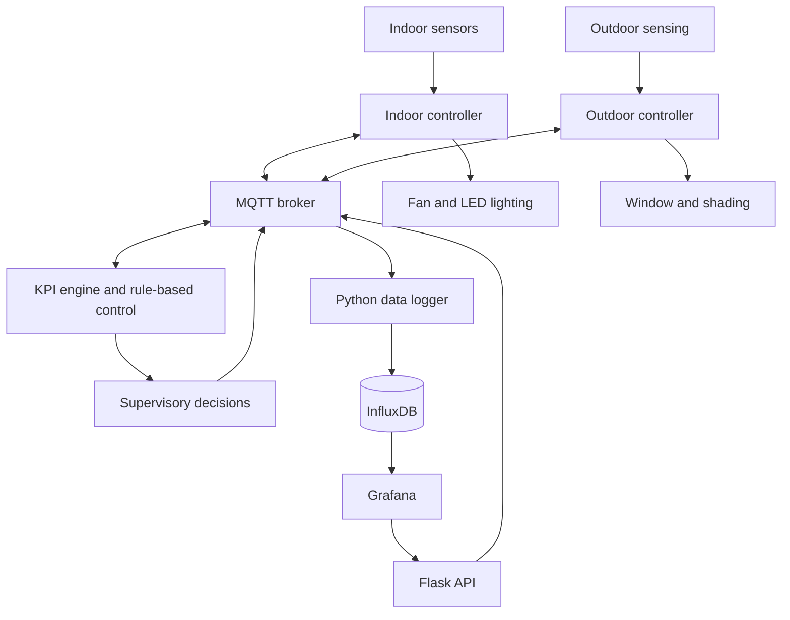

# WINECO | IoT Smart Window & Digital Twin

**Window Indoor Passive Environmental Control**

An end-to-end IoT engineering project integrating environmental sensing, automated actuation, MQTT messaging, time-series data and real-time monitoring.

     

**Politecnico di Torino · MSc ICT for Smart Societies · Interdisciplinary Projects · September 2025 – July 2026**

## Overview

WINECO was developed by a four-person team to investigate low-cost, adaptive indoor environmental control for smart buildings. The prototype monitors indoor and outdoor conditions, evaluates comfort indicators and coordinates window opening, shading, ventilation and LED lighting.

The project focuses on three Indoor Environmental Quality (IEQ) domains:

- Thermal comfort
- Visual comfort
- Indoor air quality (IAQ)

## Prototype demonstrations

| Demo | Video |
| --- | --- |
| Prototype demonstration 1 | [Watch on YouTube](https://www.youtube.com/shorts/dOBuY0DCuow) |
| Prototype demonstration 2 | [Watch on YouTube](https://www.youtube.com/shorts/y9vi3idJGnE) |

## System architecture

See the [architecture documentation](docs/architecture.md) for the distinction between the physical prototype and the team's containerized simulation.

## Technology stack

| Layer | Technologies |
| --- | --- |
| Edge / embedded | Raspberry Pi, Arduino, sensors and actuators |
| Application | Python, KPI evaluation, rule-based control |
| Messaging | MQTT, Eclipse Mosquitto |
| Backend | Flask, REST API, time-series logging |
| Data and monitoring | InfluxDB, Grafana |
| Deployment | Docker Compose, service health checks, persistent storage, restart policies and Grafana provisioning |
| External data | Weather API integration |

## Experimental validation

The prototype was evaluated in a real office environment from 26 to 29 May 2026.

| Metric | Reported result |
| --- | ---: |
| Operating hours across four test days | 71 h |
| Recorded data gaps | 8.46 h |
| Appropriate responses to recorded KPI violations | 96.215% |
| Positive feedback on KPI visualization | 86.25% |
| Survey respondents | 40 |

These results demonstrate control-system integration, not guaranteed comfort or energy savings. Thermal and visual comfort targets were not met, and CO₂ data limitations prevented full IAQ validation. See [experimental results](docs/experimental-results.md).

## Engineering process

Kick-off → System Requirements Review → Preliminary Design Review → Critical Design Review → Test Readiness Review → Final Review.

## Documentation

- [System architecture](docs/architecture.md)
- [Deployment notes](docs/deployment.md)
- [Experimental results and limitations](docs/experimental-results.md)

## Project team

- Mohsen Marzban
- Alireza Nourishad
- Shabnam Amouie
- Sajjad Rezaei Chermahini

Academic supervision: Prof. Fabio Dovis and Prof. Giacomo Chiesa.

## Repository status and attribution

This independent portfolio repository documents a collaborative academic project. It is not a GitHub fork. The [original team repository](https://github.com/Marzban-io/WINECO) contains the team's implementation. Individual contributions are not itemized here because the available documentation reports team-level work.

This repository currently contains documentation only. Source-code redistribution and deployment artifacts are subject to author permission and security review. The original Docker stack has not been independently executed here.

## Future work

- Secure configuration and reproducible container deployment.
- Automated tests and continuous integration.
- Improved sensor reliability and data-quality validation.
- Longer real-building trials and quantified energy evaluation.
- Enhanced edge autonomy and building management system integration.
