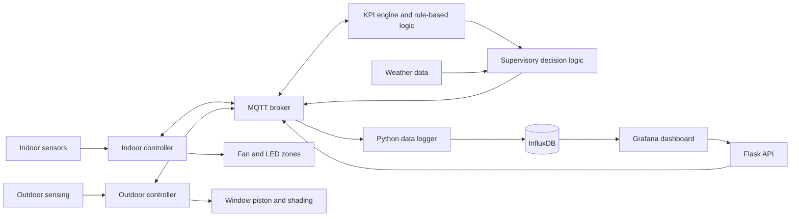

# System architecture

WINECO integrates indoor and outdoor sensing, environmental comfort evaluation, MQTT messaging, supervisory control and cloud monitoring. This document describes the academic team's implementation, not a claim that all runtime components have been published in this portfolio.

## Logical architecture

## Responsibilities

| Subsystem | Responsibility |
| --- | --- |
| Indoor node | Environmental measurements, indoor actuator control, KPI-related data |
| Outdoor node | Outdoor sensing, window piston and shading actuation |
| Comfort logic | Thermal, visual and indoor-air-quality indicators; rule-based automation |
| Supervisory control | Automatic/manual command selection and weather-aware protection |
| MQTT | Publish/subscribe communication across nodes and application services |
| Cloud/backend | Time-series logging in InfluxDB, Flask bridge, Grafana monitoring |

The physical prototype used embedded hardware and actuators. The team repository also contains a Docker-based simulation environment; simulated devices must not be confused with the physical test hardware.

## Deployment architecture in the team repository

The Compose configuration defines a Mosquitto broker, two Python 3.11 simulated edge nodes, and a cloud container. It includes a broker health check, restart policies, persistent bind mounts and Grafana provisioning. Several application scripts still require manual startup. See [deployment notes](deployment.md).

## Engineering boundaries

The final control logic is rule-based; machine-learning forecasting was an early design goal, not a demonstrated final capability. Local autonomy, resilience, and sensor accuracy remain areas for improvement.
